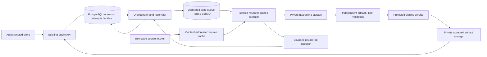

# Phase D1 — Android Build Engine architecture and feasibility

Reviewed **2026-10-29**, Asia/Dushanbe. **Analysis and architecture only.** Evidence: current source, Prisma/schema/catalog records, read-only local observations, C1–C5/final-security reports, and official Android/BullMQ documentation linked below. Proposed components and budgets are explicitly distinguished from implemented or measured capabilities.

## 1. Executive assessment and decisions

NEXOS is a working **authenticated Android configuration/draft studio**, with real PostgreSQL persistence and a deliberately closed compilation boundary. It is **not an Android compiler, build farm or firmware distributor**. No Android source tree, resolved build manifest, real build job, image or verified boot result was found.

| Decision                             | Result                                                                                                                                                                                                                                |
| ------------------------------------ | ------------------------------------------------------------------------------------------------------------------------------------------------------------------------------------------------------------------------------------- |
| Begin D2 evidence/compatibility work | **GO for a separately approved D2 scope**: profile/evidence specification, exact target/source provenance and conservative eligibility. No automatic implementation authorization.                                                    |
| Compile a real ROM now               | **NO-GO**: no approved recipe/source closure/executor/job lifecycle/artifact verifier; the observed workstation also lacks the documented platform-build capacity.                                                                    |
| First real build candidate           | **AOSP Cuttlefish x86_64 `aosp_cf_x86_64_only_phone`, userdebug**, anchored to the catalog's AOSP16 r4 reference after D2 resolves and verifies the complete source lock and exact lunch configuration. Virtual-device evidence only. |
| Physical-device support              | **NO-GO** for every catalog variant. Identity/source availability is not device/base/kernel/firmware integration or safe-installation evidence.                                                                                       |
| Public production deployment         | **NO-GO**, unchanged from the Final Security Gate. D1 does not close its operational/security findings.                                                                                                                               |

Only this report is a product-repository change. No build engine, D2 model, API, worker behavior, frontend, schema/index, dependency, secret or deployment was implemented or changed. No compilation, flashing, large source download, queue enqueue, worker startup or infrastructure restart was performed.

## 2. Existing inventory and actual lifecycle

“Fully implemented and verified” below is scoped to the named existing feature, supported by the C5 regression evidence—not an assertion that an Android build was verified. Fresh D1 checks are listed in section 12.

| Lifecycle step                                | Classification                                                                           | Concrete evidence and limits                                                                                                                                                                                                                                                                                                       |
| --------------------------------------------- | ---------------------------------------------------------------------------------------- | ---------------------------------------------------------------------------------------------------------------------------------------------------------------------------------------------------------------------------------------------------------------------------------------------------------------------------------- |
| Sign in/create an owned project               | **Fully implemented and verified** for draft persistence                                 | [API create/save/owner checks](../../apps/api/src/app.ts#L554), [ROMProject/ConfigurationRevision](../../packages/database/prisma/schema.prisma#L331), C5 real PG/auth/ownership tests. Initial snapshot and optimistic revision update are real database operations.                                                              |
| Select manufacturer/exact device variant/base | **Fully implemented and verified** as catalog selection                                  | [Selection checks](../../apps/api/src/app.ts#L565), [catalog data](../../packages/database/prisma/catalog-data.ts#L69), [safe seed](../../packages/database/prisma/catalog-seed.ts#L42). New selections require active catalog records; unchanged legacy references remain editable. This does not select a working build target.  |
| Configure “Android”                           | **Partially implemented**                                                                | [Strict configuration schema](../../packages/contracts/src/requests.ts#L55) validates/persists name, description, variant/base, preset, color, dark mode, app-role intentions and literal unconfigured kernel. No translation into Android product definitions, overlays, packages, SELinux policy or kernel configuration exists. |
| Phone appearance                              | **Simulated/visual approximation**                                                       | [Studio preview](../../apps/web/components/studio.tsx#L438) is browser markup/CSS, not an Android renderer or generated image. Presets/apps are intentions, not executable integrations. No simulated successful compilation was found.                                                                                            |
| Save/review/validate                          | **Partially implemented** for build eligibility; real fail-closed validation is verified | [Studio save](../../apps/web/components/studio.tsx#L115) calls project POST/PATCH and optionally `/validate`. [Validator](../../packages/contracts/src/requests.ts#L142) always returns UNKNOWN/foundation-1 with manifest/worker blockers. It does not resolve a dependency graph.                                                |
| User requests compilation                     | **Partially implemented**, rejection path only                                           | [Build handler](../../apps/api/src/app.ts#L714) authenticates/owns/validates then 503; no queue producer. [Build button](../../apps/web/components/studio.tsx#L404) is disabled. C5 tests assert503. A “review/save” action is not a queued build.                                                                                  |
| Persist/admit/enqueue a build                 | **Not implemented**                                                                      | No BuildRequest/BuildAttempt/BuildManifest/outbox model in Prisma; no `Queue.add` producer in apps/packages/scripts. Current ROMProject has configuration/revisions, not build state.                                                                                                                                              |
| Worker processes Android job                  | **Not implemented**                                                                      | [Worker](../../apps/worker/src/main.ts#L1) accepts only `healthcheck`; every other name throws. No source sync, command runner, sandbox/executor or compiler invocation.                                                                                                                                                           |
| Queue foundation                              | **Partially implemented; source/type checked, not exercised end-to-end in D1**           | BullMQ consumer/configuration exists. No health job was enqueued or worker started for this audit. Queue metadata alone is not a successful job test.                                                                                                                                                                              |
| Build status/progress/cancel/recovery         | **Not implemented**                                                                      | No build-state model, owned build-status endpoint, progress event stream, cancellation protocol, durable executor lease or reconciliation loop. Worker failure console events are not a user build-status service.                                                                                                                 |
| Validate/sign/publish artifacts               | **Not implemented**                                                                      | [Legacy Artifact/Release/VerificationRecord schema](../../packages/database/prisma/schema.prisma#L185) is scaffolding. No image verifier, signer, object client, publication policy or artifact-download endpoint was found.                                                                                                       |
| “Download” current configuration              | **Implemented as JSON export, not a ROM artifact**                                       | [Studio download](../../apps/web/components/studio.tsx#L143) creates `nexos-configuration.json`. It does not produce boot/system images or an OTA ZIP. No new browser download test was executed in D1.                                                                                                                            |

### Code and data boundaries that matter

- [BUILD_SYSTEM.md](../../BUILD_SYSTEM.md), [DEVICE_SUPPORT.md](../../DEVICE_SUPPORT.md), [architecture](../../ARCHITECTURE.md), [database notes](../../DATABASE.md), [C5 report](../backend/phase-c5-openapi-contract-tests.md) agree that compilation is unavailable. Older foundation reports are historical; they do not override current source.
- The API currently has21 operations; no build-status/artifact API is hidden behind the documented503 endpoint. `pnpm build` builds Next.js/TypeScript/Prisma packages, **not Android**. The existing build-related scripts do not install Repo/SDK or compile AOSP.
- `ROMProject` links an owner to JSON/revisions. `AndroidBase` is a source catalog with no per-device compatibility relation. The legacy `Artifact` belongs to `Release → Project`, **not** to an owned ROMProject build attempt. These legacy tables must not be silently repurposed or treated as a ready build ledger.
- `CompatibilityRule`/firmware fields are legacy release/variant relations. [evaluateCompatibility](../../packages/utils/src/index.ts#L10) is unit-tested but not called by the current apps; an evidence URL's presence and matching conditions are not provenance verification. Do not wire that helper into build admission as a sufficient trust decision.
- BuildSupportStatus contains only NOT_VERIFIED [schema lines16–19](../../packages/database/prisma/schema.prisma#L16). New states/evidence persistence need an approved additive design/migration and matching contract review. Nothing is migrated in D1.

## 3. Worker, Redis, storage and live observations

Installed worker resolution is **BullMQ 5.81.5** (manifest range `^5.61.0`). [Worker package](../../apps/worker/package.json) builds with tsc. Its fixed queue is `romhub-foundation`, concurrency 2, with no producer in the repository. The handler ignores probe payload and returns `{status:'ok'}` only for healthcheck. That is connectivity scaffolding, not a simulated compiler.

Current worker gaps, already consistent with earlier audits:

| Boundary         | Observed implementation                                                                                                                                                      | Required before real jobs                                                                                                                              |
| ---------------- | ---------------------------------------------------------------------------------------------------------------------------------------------------------------------------- | ------------------------------------------------------------------------------------------------------------------------------------------------------ |
| Redis URL        | hostname/port and raw URL credential fields extracted; rediss adds TLS object. Database pathname ignored; protocol/credentials not validated/decoded like API configuration. | Reviewed parser consistent with API deployment requirements, explicit database/prefix/TLS/ACL behavior. No fix in D1.                                  |
| Logs             | failed/error listeners emit raw error.message [lines24–36](../../apps/worker/src/main.ts#L24).                                                                               | Sanitized structured events; redact at collection, no raw source credentials/environment. No confirmed secret leak is asserted from static code alone. |
| Shutdown         | SIGINT/SIGTERM await worker.close.                                                                                                                                           | Build deadlines, bounded executor termination, lease/fencing and orphan cleanup; a graceful queue close alone cannot guarantee stopping compilers.     |
| Concurrency      | 2 lightweight jobs per worker process.                                                                                                                                       | Resource admission across replicas; never interpret this as capacity for two full Android builds.                                                      |
| Delivery/retries | BullMQ primitives only; no NEXOS retry/cancel/publication protocol.                                                                                                          | Durable idempotent orchestration and crash recovery.                                                                                                   |

D1 read-only observations: PostgreSQL has **7 active real devices/11 active variants/2 bases**. Across all14 stored variants, all are NOT_VERIFIED; the extra3 are legacy unverified entries. Active source metadata comprises10 SOURCE_AVAILABLE variants and one UNREVIEWED Redmi variant. No build/job/manifest delegates exist; Artifact, Release, CompatibilityRule and VerificationRecord row counts are0. These are observations of this local database, not global deployment claims.

Redis had one foundation metadata key. Read-only state counts were0 for wait/active/paused/delayed/completed/failed/waiting-children. No worker Node process was observed in its workspace at inspection time. This does not prove that the queue was never used or that processing works; no runtime probe was submitted.

[Compose](../../infrastructure/docker/compose.yaml#L15) provides Redis/PostgreSQL; optional extended-profile MinIO/search are scaffolding. MinIO is not wired into API/worker, and no storage container was observed in the local Podman list. Development storage defaults and the old pinned container image are not a production storage/security review. The authentication limiter's Redis implementation is real, but it is **not** a build scheduler. Large build queues should have a separate resource/security budget; a namespace alone cannot prevent shared Redis memory/CPU pressure from taking authentication offline.

## 4. Android compilation integration requirements

This is a proposed integration, not commands executed in D1.

| Layer              | Practical requirement and decision                                                                                                                                                                                                                                                                                                                                                                    |
| ------------------ | ----------------------------------------------------------------------------------------------------------------------------------------------------------------------------------------------------------------------------------------------------------------------------------------------------------------------------------------------------------------------------------------------------- |
| AOSP platform      | Full source/build tree and product configuration; choose one reviewed immutable baseline first. App Gradle/SDK builds do not generate the OS. The existing AOSP16 source entry is a starting reference, not a resolved build plan.                                                                                                                                                                    |
| Git/Repo           | Repo aggregates Git projects using a manifest. Freeze manifest commit, every project SHA, submanifests, patches and prebuilt digests; verify release signatures against reviewed trust anchors where available. A mutable branch or merely pinned top-level manifest is insufficient if child revisions still float. See [official download process](https://source.android.com/docs/setup/download). |
| Toolchain          | Reviewed Linux builder image, branch-specific host prerequisites and pinned JDK/Python/Clang/build-tool prebuilts from the approved tree. Do not install arbitrary latest tool versions or assume a global host JDK matches the branch. [AOSP setup](https://source.android.com/docs/setup/start/requirements).                                                                                       |
| Soong/Ninja        | Approved envsetup/product/lunch recipe drives the platform build; Android.bp/legacy Android.mk integration is not a JSON-to-Ninja conversion. Soong uses Ninja and Kati in the documented build path. [Build overview](https://source.android.com/docs/setup/build).                                                                                                                                  |
| SDK/platform tools | Pin adb/fastboot/related host tooling only where tests or installation workflows need them. Platform Tools provides device communication tools, not the Android OS compiler. No adb/fastboot or flashing operation was executed. [Official Platform Tools](https://developer.android.com/tools/releases/platform-tools).                                                                              |
| Device integration | Exact product/device/common trees, BoardConfig, overlays, HAL/VINTF/SELinux, firmware and partition recipes must match the chosen release/variant. A chipset name or kernel repository alone is insufficient.                                                                                                                                                                                         |
| Kernel             | Record source/commit or approved prebuilt, config, compiler, modules/KMI, DTB/DTBO and vendor integration. GKI separates a common kernel from vendor modules; it is not universal hardware support. [GKI](https://source.android.com/docs/core/architecture/kernel/generic-kernel-image).                                                                                                             |
| Vendor components  | Exact binary provenance/hash/version and extraction/build/redistribution rights. AOSP's download documentation distinguishes Cuttlefish from physical hardware needing device-specific proprietary libraries. Google driver downloads have restrictive terms; availability is not blanket redistribution permission. [Driver binaries/terms](https://developers.google.com/android/drivers).          |
| Build outputs      | Define the exact expected target-files/images/host-package/OTA goals for the pinned branch. Record what was compiled versus consumed as a prebuilt. A successfully produced ZIP is not automatically an installable ROM or boot proof.                                                                                                                                                                |
| Reproducibility    | Record resolved source lock, builder image digest, tool versions, product/release/variant, environment allowlist, configuration/patch hashes and timestamps policy. Aim for repeatable inputs first; demonstrate bit-identical outputs separately, including nondeterministic ZIP/signing/build metadata.                                                                                             |

Current official setup/download pages use moving “latest” release references; they must not silently change NEXOS's pinned AOSP16 base. The documentation's current target example uses `aosp_cf_x86_64_only_phone-aosp_current-userdebug`; exact release-config availability must be checked against the selected ref, rather than assuming a modern example fits every branch. [Build target syntax](https://source.android.com/docs/setup/build/building).

### Generic, GSI and physical-device results are different

- **Cuttlefish:** first platform compiler/virtual-boot integration target. Matching image and host packages are required; KVM availability is a separate boot-test prerequisite. [Cuttlefish setup](https://source.android.com/docs/devices/cuttlefish/get-started).
- **GSI:** a generic system image for compatibility testing does not supply an arbitrary phone's kernel, vendor firmware, partition plan or installation procedure. Treble/GSI suitability must still be evidenced. [GSI documentation](https://source.android.com/docs/core/tests/vts/gsi).
- **Physical device:** requires exact hardware integration and authorized bench installation/boot/hardware tests. Virtual boot success proves nothing about Redmi, Pixel, Galaxy or OnePlus flashability.

Public AOSP test keys are unsuitable for public releases. Signing APK/APEX/OTA/image metadata, device AVB policy, rollback protection and trusted-key provisioning are separate responsibilities; a SHA-256 digest does not prove a signature or safe boot. [Release signing](https://source.android.com/docs/core/ota/sign_builds), [AVB](https://source.android.com/docs/security/features/verifiedboot/avb).

## 5. Conservative device eligibility and evidence

The real catalog currently identifies Redmi Note10/mojito, Pixel6/oriole, Pixel7/panther, Pixel8/shiba, Galaxy S10/beyond1lte, S10e/beyond0lte and OnePlus7 Pro/guacamole with explicitly scoped variants. No D1 claim of Android16 support for those devices is made. In particular, the Redmi source record is UNREVIEWED; Samsung/OnePlus Lineage metadata is not OEM approval; Pixel source links are not complete device-build closure. [Existing catalog ledger](../catalog/README.md).

Propose an **evidence-bearing target profile**, separate from identification and UI intentions:

| Dimension                 | Required recorded evidence                                                                                                                                                                                                                                                                                                     |
| ------------------------- | ------------------------------------------------------------------------------------------------------------------------------------------------------------------------------------------------------------------------------------------------------------------------------------------------------------------------------ |
| Identity                  | Exact manufacturer/model/codename/SKU/hardware revision and region/carrier limits; exclude similar names/chipsets. Don't infer unlockability from a marketing name. Avoid storing unnecessary IMEI/serial personal data.                                                                                                       |
| Platform/source           | Supported branch **for this profile**, pinned manifest/project tree/common tree/toolchain/patches; reviewed maintainer/source records and retrieval time. Empty androidVersions in newly seeded variants is not wildcard compatibility.                                                                                        |
| Kernel/vendor             | Approved kernel or prebuilt digest, config/KMI/modules/DT integration; vendor extraction origin, firmware versions and rights. Hardware availability checks are not substitutes for licensing or module compatibility.                                                                                                         |
| Boot/layout               | Profile-specific boot header, init_boot/vendor_boot/boot/recovery/DTBO/AVB/dynamic partitions/super/A-B/fastbootd details **where applicable**, image sizes and rollback requirements. Do not assume every device has the same partitions. [Partition overview](https://source.android.com/docs/core/architecture/partitions). |
| Framework/vendor boundary | Matching device/framework manifests and compatibility matrices, supported HALs/security policy, architecture and relevant page-size requirements. [VINTF](https://source.android.com/docs/core/architecture/vintf).                                                                                                            |
| Installation              | Reviewed exact-device installation/recovery/firmware procedure, prerequisites, failure recovery and authorized owned test hardware. No universal flash instructions or automated flashing in this phase.                                                                                                                       |
| Provenance                | Source URL + content digest + revision + publisher + reviewer + reviewed/expiry dates + exact profile association + attached test logs/artifact digests. A URL alone is not trusted evidence; stale/revoked inputs invalidate eligibility.                                                                                     |

Suggested **independent** gates, not a support “score”:

1. IDENTITY_REVIEWED: identification only.
2. SOURCE_LOCK_REVIEWED and RIGHTS_REVIEWED: complete reproducible input closure and permitted use scope.
3. RECIPE_APPROVED + CONFIG_SUPPORTED + EXECUTOR_POLICY_PASSED: allowed to **attempt** compilation for that exact immutable profile.
4. COMPILE_PASSED: compiler exited successfully with expected outputs; no boot guarantee.
5. ARTIFACT_VALIDATED and VIRTUAL_BOOT_PASSED or DEVICE_BOOT_PASSED: scope-specific evidence.
6. HARDWARE_TESTED/INSTALLATION_REVIEWED: dated physical-device test matrix, separate from compile/signing.

Missing evidence means UNKNOWN/BLOCKED; known contradictions mean UNSUPPORTED; explicit prerequisites can be CONDITIONAL but must block admission until verified. Don't promote catalog SOURCE_AVAILABLE or a selected base to BUILD_VERIFIED. A profile may be revoked without rewriting a user's saved project.

All existing configuration fields need an approved semantic mapping before being accepted for a real build. Unsupported presets, app choices, accents or kernels must be rejected as unsupported intentions, not silently ignored while promising a customized OS. The first generic baseline should have no promised user customizations. Virtual targets need their own explicit target-kind design; do not insert Cuttlefish as a fake phone variant to bypass current selectors.

Any future build/evidence models, enum extension, API success/status contract or target-kind change requires its own approved additive design. Current503/UNKNOWN/NOT_VERIFIED behavior stays in place until the prerequisites actually exist.

## 6. Proposed Build Engine architecture — not implemented

| Boundary             | Proposed responsibility                                                                                                                                                                                                                                                                                              |
| -------------------- | -------------------------------------------------------------------------------------------------------------------------------------------------------------------------------------------------------------------------------------------------------------------------------------------------------------------- |
| Public API           | Authenticate/own, freeze an authorized revision/profile/configuration, enforce quotas/eligibility and persist a request/outbox atomically. No source fetch/build scripts on API host. Future job/status/cancel/delivery contracts require explicit approval; none added now.                                         |
| PostgreSQL           | Canonical request/attempt/lease/event/outbox state. Snapshot the project revision, resolved recipe/source hashes, actor and policy version so later edits cannot alter an admitted job.                                                                                                                              |
| Orchestrator         | Dispatch outbox idempotently, reserve resource slots, lease an attempt, schedule deadlines, reconcile crashes and control cancellation. Job payloads contain IDs/hashes, not passwords or arbitrary shell/URLs.                                                                                                      |
| Queue Redis/BullMQ   | Delivery/backpressure only, separate namespace and preferably separate deployment/resource budget from authentication. Queue completion is not proof of artifact verification/publication.                                                                                                                           |
| Executors            | Disposable VM/microVM per trust boundary, non-root guest build, cgroup CPU/RAM/disk/PID/I/O limits, bounded wall time. Rootless containers can help packaging but are not by themselves a hostile-code security boundary. No Docker socket/host secrets/API DB access.                                               |
| Fetcher/cache        | Allowlisted reviewed repositories and immutable refs; separate fetch network from build execution. Read-only shared trusted cache, per-attempt writable workspace. Cache key includes source/toolchain/target/recipe/configuration/trust domain. Prevent cross-user cache poisoning and unauthorized vendor sharing. |
| Logs/events          | Collect/redact before storage, bounded chunks/bytes/rate/retention; private owner-authorized replay/progress with monotonic event sequence. No fabricated percentage; report real stage/observed compiler progress or indeterminate work.                                                                            |
| Validation/signing   | Parse/unpack images in an isolated verifier; provenance, hashes, size/layout/AVB/expected files and boot policy. Signing service receives only policy-accepted digests/manifests; release keys never enter build guests.                                                                                             |
| Artifact storage/API | Private staging then immutable accepted objects. Owner/profile/revision provenance, integrity/signing metadata and expiring authorized delivery. Legacy Release/Artifact relations need deliberate mapping/new models; do not treat a configuration JSON export as an image.                                         |

Trusted control-plane provenance must bind the attempt, source lock, executor image and output digests. Guest-reported checksums/SBOMs are untrusted inputs; the independent verifier recomputes digests. A signature or provenance statement does not, by itself, establish source-to-binary reproducibility.

Build sources themselves are executable/untrusted even if the UI only sends JSON: product Makefiles, generators, repo hooks and native tools can execute arbitrary code. Review/allowlist recipes, reject user shell fragments/paths/remotes, validate manifest copy/link paths, and isolate execution even after review. Never concatenate user project names/app IDs into shell commands.

### Job lifecycle, retries and recovery

Proposed states: RECEIVED → ELIGIBILITY_CHECK → QUEUED → PREPARING → COMPILING → VALIDATING → SIGNING/PUBLISHING → SUCCEEDED. Terminal alternatives: REJECTED, FAILED, CANCELLED, TIMED_OUT; infrastructure loss has an explicit LOST/RECONCILING attempt state. “SUCCEEDED” means policy-defined validated output, not automatic physical-device compatibility.

- DB transaction includes request snapshot and outbox; dispatcher uses a stable queue job ID. Queue insertion is retriable without inventing a second request. BullMQ stalled work can be processed again; never rely on exactly-once delivery. Its documentation calls for idempotent jobs and warns about event-loop stalls. [Stalled jobs](https://docs.bullmq.io/guide/jobs/stalled), [idempotency](https://docs.bullmq.io/patterns/idempotent-jobs).
- Every execution gets an attempt UUID and durable lease/fencing token. Only the current authorized attempt can commit completion. Uploads are attempt-scoped; a stale/replayed executor cannot overwrite or publish accepted objects. Reconciliation, not queue state alone, decides recovery.
- Proposed initial retry budget: at most2 transient infrastructure retries with bounded backoff/jitter. No automatic retry for deterministic compile errors, missing evidence, license rejection or unsupported configuration. All retries consume the user's/global resource budget and retain separate attempt evidence.
- Cancellation persists intent first. Queued removal is only an optimization. Active cancellation stops the whole executor/process tree within a grace period, verifies termination, aborts staging uploads and only then releases capacity. Never assume deleting a queue record kills a compiler. Completion/cancel races resolve transactionally; ambiguous executors remain fenced/quarantined.
- CPU-heavy work must not block the orchestration Node event loop/lock renewals. Start with one full compiler slot per properly provisioned worker; separate CPU/RAM/disk admission from BullMQ's lightweight worker concurrency 2. Persist global/per-user reservations to prevent replica oversubscription.
- After crash, detect expired leases, reconcile actual executor state, stop or fence orphan attempts, retain diagnostics and retry only under budget. Test failure after enqueue, after compile, during upload and before/after final DB commit. Idempotent immutable publication plus DB constraints prevent duplicate accepted artifacts.

Suggested prototype timeout policy to approve later: separate source/prepare deadline and whole-build deadline; an initial24-hour hard build ceiling is a **budget proposal, not a duration forecast**. Bound cancellation time, output count/bytes and log growth independently. Don't defer isolation or crash safety until a “production hardening” phase.

## 7. Resources: published guidance, measured host and planning estimates

Official current AOSP guidance specifies x86_64 Linux, at least400 GB disk (250 checkout +150 build) and64 GB RAM. Its examples compare roughly40 minutes on72 cores/64 GB with6 hours on6 cores/64 GB. These are Google's published illustrations, **not NEXOS benchmarks or predictions**. The page now references Android17; use the figures as conservative planning guidance for the older proposed baseline until measured. It provides Ubuntu prerequisite instructions; Fedora-native branch compatibility was not validated here. [AOSP requirements](https://source.android.com/docs/setup/start/requirements).

**Observed D1 development host, not a benchmark:** Fedora44/x86_64, Ryzen7 7445HS,6 physical cores/12 logical CPUs, about15 GiB total RAM (~7.3 GiB available at observation),8 GiB swap, repository filesystem about98 GiB total/69 GiB free. `/dev/kvm` exists and is readable/writable; that does **not** prove successful virtualization, nested KVM or Cuttlefish boot. Other volumes, actual network throughput and sustained CPU/I/O performance were not assessed. This host is suitable for current control-plane/evidence development, **not a qualified full-build executor**. Swap is not a substitute for the required memory/disk plan.

The following are **engineering budgets to validate**, not measured minimums or purchase recommendations:

| Scenario                     | CPU/RAM                                                                                    | Storage/network                                                                               | Intended use                                                                                                                                     |
| ---------------------------- | ------------------------------------------------------------------------------------------ | --------------------------------------------------------------------------------------------- | ------------------------------------------------------------------------------------------------------------------------------------------------ |
| Current local development    | Existing host; small API/worker/evidence tests                                             | Existing free space; no source checkout                                                       | D2 design/metadata and D3 synthetic lifecycle tests. No full Android build.                                                                      |
| Executor isolation prototype | 4–8 vCPU,4–8 GiB test guest                                                                | Small bounded test disk; controlled egress                                                    | D4 harmless workloads, quotas/cancel/crash tests. Does not demonstrate Android build capacity.                                                   |
| First dedicated compiler     | 16–24 logical CPUs,64–96 GiB RAM; begin with1 active build                                 | At least1 TB dedicated fast storage, preferably more headroom;1 Gbit/s networking as a target | D5 measurement candidate; choose a pinned branch-tested Linux image, e.g. reviewed Ubuntu-based guest, without changing the Fedora host.         |
| Single-server private lab    | 24–32 logical CPUs,128 GiB RAM; reserve resources for control plane and boot verifier      | About2 TB fast storage plus separate artifact/backup budget                                   | Initially1 build; logical/VM network separation and no API starvation. Shared physical host remains a risk requiring measured isolation.         |
| Scalable pool                | Per-executor16–32 vCPU/96–128 GiB,1–2 TB scratch; separate small API/orchestrator services | Shared immutable source cache/private object storage; measured egress/IOPS                    | Autoscale only under admission/tenant limits; account for cold sync and nested-virtualization availability. Not an implemented cloud deployment. |

Disk budget model: `source S + active_jobs × (output O + scratch J) + local_cache C + staging L + free_reserve R`. Illustrative decimal-GB assumptions S250/O150/J100/C150/L50/R200 yield900 GB for one job. This is a scenario, not measured Cuttlefish output. Never multiply concurrency while sharing one mutable out directory. An extra target/branch/output can exceed the budget; enforce admission watermarks and stop before filling API/DB disks.

Memory admission should reserve host/control-plane memory and account for VM/boot-verifier overhead: do not infer two jobs fit merely because a worker advertises concurrency 2. Start with bounded compiler parallelism and raise it only after observing peak RAM/IO/thermal behavior.

No sync/build timing was measured. Network lower bound is `bytes_to_transfer × 8 / bits_per_second`, not checkout size divided by bandwidth. For a **hypothetical100 GB transfer**, line-rate minima are about2.2 hours at100 Mbit/s or13.3 minutes at1 Gbit/s, excluding protocol, throttling, retries and disk work. Actual packed source traffic must be measured. Treat the first cold build as a multi-hour experiment with an explicit deadline, not an advertised SLA.

Storage retention model: `successful_jobs/day × retained_days × actual_bytes/job × retained_copies`, plus failed/staging objects/logs and legally required source material. Hypothetically5 jobs/day ×14 days ×10 GB ×2 copies =1.4 TB. The10 GB is an assumption, not a measured artifact size. Separate quotas for scratch, caches, accepted artifacts and logs; propose short private-lab retention only after legal/recovery requirements are reviewed. Cache/SBOM/source retention and backups cannot be inferred from that single formula.

## 8. Security, reliability, licensing and firmware safety

| Risk                                 | Required control/gate before enabling real work                                                                                                                                                                                                                                                                                                                                                                 |
| ------------------------------------ | --------------------------------------------------------------------------------------------------------------------------------------------------------------------------------------------------------------------------------------------------------------------------------------------------------------------------------------------------------------------------------------------------------------- |
| Host compromise from build rules     | Disposable VM/microVM, least privilege, resource/time/PID/I/O caps, no host socket/mounts/production credentials. Malicious source tests and executor escape review before D5.                                                                                                                                                                                                                                  |
| Repository/supply-chain substitution | Allowlisted origins, reviewed signing keys, immutable full manifest/project locks, verified prebuilts/patch hashes, pinned executor image and provenance/SBOM. Treat redirected URLs, hooks and submanifest dependencies as inputs requiring review.                                                                                                                                                            |
| Cache poisoning                      | Trust-domain separation, immutable digest addressing, controlled writers, isolated outputs; don't share private proprietary inputs without rights/access controls.                                                                                                                                                                                                                                              |
| Secrets/signing compromise           | Separate signer with short-lived narrowly scoped access; no API session/HMAC/DB credentials inside guests. Test keys only for explicitly private development; never describe them as production signing.                                                                                                                                                                                                        |
| Queue/resource abuse                 | Per-user/global CPU-hour, active/queued/disk/output quotas, admission reservations and independent build controls. Authentication rate limiting does not rate-limit Android compute. Protect auth Redis from build traffic.                                                                                                                                                                                     |
| Crash/replay/publication races       | Outbox, fencing/lease/reconciliation, immutable attempt outputs, idempotent final commit and fault-injection recovery tests.                                                                                                                                                                                                                                                                                    |
| Log/artifact attacks                 | Text escaping, ANSI/control handling, redaction at collection, bounded log chunks/archives, path/symlink/ZIP-bomb checks and isolated image parsers. Never mount arbitrary produced images on the API host.                                                                                                                                                                                                     |
| Artifact access/retention            | Private staging/accepted buckets, ownership checks, expiring authorized downloads, sanitized names, checksums/provenance, lifecycle reconciliation. Future size wire contracts must handle existing legacy BigInt fields without unsafe JS-number coercion.                                                                                                                                                     |
| License/redistribution               | Per-component license/NOTICE/source/patch obligations and proprietary agreements; review permitted build, private use and redistribution separately. AOSP being largely Apache2 does not erase kernel GPL or vendor restrictions. This audit grants no distribution rights. [AOSP FAQ](https://source.android.com/docs/setup/about/faqs), [Google driver terms](https://developers.google.com/android/drivers). |
| Unsafe firmware                      | Exact variant/branch/firmware/partition/rollback profile, AVB/signature and boot/hardware evidence; no generalized flash guarantee, automatic flashing or treating emulator success as phone support.                                                                                                                                                                                                           |

GMS/Play certification, DRM, banking/attestation behavior and OTA/relocking safety are not outcomes of a successful AOSP compilation. Do not package proprietary Google apps or claim certification without the separate rights/program requirements. Android compatibility and potential GMS licensure have separate program requirements. [Compatibility program](https://source.android.com/docs/compatibility/overview). A device-specific installation phase must use authorized recoverable test hardware and explicit approved procedures; no flashing was performed here.

## 9. Proposed incremental D2–D8 roadmap

All rows are **future approval scopes**, not implemented work. Future schema/API/secret/infrastructure changes must be approved explicitly, preserving existing users/projects and the closed build endpoint until safe activation.

| Phase                                             | Scope/dependencies                                                                                                                                                                                                                                              | Acceptance criteria and tests                                                                                                                                                                                                                                                                                                                          | Infrastructure/risk                                                                                                                                                               |
| ------------------------------------------------- | --------------------------------------------------------------------------------------------------------------------------------------------------------------------------------------------------------------------------------------------------------------- | ------------------------------------------------------------------------------------------------------------------------------------------------------------------------------------------------------------------------------------------------------------------------------------------------------------------------------------------------------ | --------------------------------------------------------------------------------------------------------------------------------------------------------------------------------- |
| **D2 — Evidence and target eligibility**          | Define virtual vs physical target profiles, source-lock/evidence/rights/reviewer/revocation semantics; verify the proposed AOSP16/Cuttlefish metadata. Depends on D1/C contracts. Propose additive persistence/contract changes before implementing migrations. | Exact supported tuple; no support inferred from base/catalog; stale/contradictory/incomplete evidence blocks; model/variant mismatch tests, schema tests, source-digest/reviewer tests and a reviewed first generic profile. No compilation.                                                                                                           | Current development host sufficient for metadata/small source-file review. Risks: inaccessible sources, unverifiable vendor rights, wrong release-config assumptions.             |
| **D3 — Orchestration/lifecycle**                  | Approved request/attempt/outbox/lease model and owned status/cancel contracts; queue admission, quotas, idempotency and reconciler. Depends on D2 profile rules; build API still unavailable until a real executor is admitted.                                 | Synthetic executor clearly labeled tests only; transaction/duplicate/crash/cancel races, Redis outage, DB/queue dual-write recovery and authorization tests. No fake product build success.                                                                                                                                                            | Small isolated PG/Redis test environment; separate build-queue budget/design. Risks: stalled redelivery, orphan capacity, cross-owner status/log leaks.                           |
| **D4 — Isolated executor prototype**              | Reviewed image/runner protocol, egress policy, cache isolation, staging upload and bounded logs. Depends on D3 lifecycle; no real Android source execution yet.                                                                                                 | Harmless bounded workloads prove CPU/RAM/disk/PID limits, cancellation/process-tree termination, timeout, crash/fencing, secret/network isolation and cleanup. Provision qualified D5 capacity.                                                                                                                                                        | 4–8 GiB test VM can prove plumbing; real build hardware needed separately. Risks: host escape, privileged runtime shortcuts, unsupported nested virtualization.                   |
| **D5 — First generic Android baseline**           | One approved immutable AOSP/Cuttlefish profile on the D4 executor; no unsupported UI customization. Full resolved source and prebuilt provenance required.                                                                                                      | Actual source sync/build, expected-image integrity/layout checks, same-build host tools and isolated virtual-boot smoke evidence; keep logs/digests/inputs and classify compiled vs prebuilt components. No physical-device support or public release. Repeat clean attempt and compare provenance; do not promise bit reproducibility until measured. | Dedicated64–96 GiB/1 TB+ worker and suitable boot-test capacity. Risks: sync/toolchain/target drift, OOM/ENOSPC, long runtime.                                                    |
| **D6 — Artifact validation and private delivery** | Harden validators, separate signer, immutable storage, provenance/SBOM/rights gates, authorized delivery and retention. Depends on D5 actual output schema.                                                                                                     | Tamper/truncation/wrong-profile/oversize/archive attack tests; signer isolation, key policy, upload/commit races, owner-only expiring download and cleanup/restore tests. No artifact published before policy passes.                                                                                                                                  | Private object store, verifier/signer separation and measured artifact capacity. Risks: key exposure, unsafe parsers, unauthorized redistribution.                                |
| **D7 — One physical-device profile**              | Separately reviewed exact model/variant/base/kernel/vendor/firmware/installation integration. Depends on D2 and D5–D6; no bulk “all catalog supported” promotion.                                                                                               | Approved hardware-lab procedure and recovery prerequisites; actual authorized install/boot/hardware matrix and evidence tied to exact artifacts. Report failures/unsupported functions. Future flashing requires explicit approval, never this D1 report.                                                                                              | Owned recoverable bench hardware and qualified worker; rights/firmware/rollback risks may block support indefinitely. No model selected as guaranteed today.                      |
| **D8 — Capacity/reliability/security gate**       | Load/fairness/resource accounting, multi-worker failure/failover, disaster recovery, lease/queue/storage reconciliation, security and operational review. Mandatory isolation was already established in D4, not postponed here.                                | Measured peak resources/SLA candidates, adversarial quotas, restore/recovery RPO/RTO, loss/duplicate/cancellation tests, alert/runbook drills and deployment-specific approval. Public release is a separate decision.                                                                                                                                 | Realistic worker/storage/queue topology, spare capacity and monitoring. Risks: high-cardinality abuse, shared-service starvation, data/key loss and untested production topology. |

**Sequence adjustment:** D5 must include minimal artifact validation and virtual boot before calling a generic build verified; D6 then hardens signing/storage/delivery. Otherwise a “verified build” would precede the evidence that verifies it. Physical-device verification remains D7 and does not follow automatically from D5.

## 10. Specific first target recommendation

Recommend a **private, unchanged AOSP Cuttlefish x86_64 userdebug baseline**, not Redmi/Pixel/Samsung/OnePlus first. Candidate product: `aosp_cf_x86_64_only_phone`; official example release configuration: `aosp_current`. This is a documented virtual target and avoids claiming any physical OEM/vendor integration. [Official target example](https://source.android.com/docs/setup/build/building).

Anchor D2 review to existing catalog ID `aosp-16-r4`, source ref `refs/tags/android-16.0.0_r4`, recorded manifest commit `15128c9e27cfa599c48d294babd39286ee8f1426` [catalog data](../../packages/database/prisma/catalog-data.ts#L178). Do not change to a moving latest/main branch implicitly. D1 could read current official workflow documentation, but both small Gitiles fetches for the pinned manifest/product file were unavailable; **exact target/release-config membership at this pin is not independently reverified here**. The recorded commit is catalog evidence, not a D1-resolved full project lock.

D2 must resolve that ref and every project/prebuilt, confirm the product and release configuration actually exist together, review notices/rights, and produce an approved lock/recipe. If the proposed tuple is unavailable or inappropriate, explicitly review an alternative release/profile rather than silently substituting current docs' defaults. No Android source tree was downloaded and no lunch command was executed.

Expected initial research/build evidence: resolved lock and executor digest, generated target-files/images and matching host package as appropriate to the chosen goals, checksums, toolchain/build logs, and boot-smoke results in an isolated Cuttlefish environment. Public/default test signing must be labeled development-only; no user-device flashable claim. The baseline need not rebuild an upstream kernel prebuilt; if one is consumed, identify its provenance and do not claim it was compiled by NEXOS.

## 11. D2 readiness decision

**GO to request/approve D2 evidence work; NO-GO to enable compilation or claim device readiness.** The missing source-pin verification is an explicit D2 task, not a waived build prerequisite. D2 can proceed on the present control-plane workstation because it is metadata/review work; D4/D5 require additional capacity and verified isolation. No first-build wall-time/cost promise is supportable before that experiment.

D2 should first deliver the target/evidence schema and migration proposal, exact first-profile closure, conservative eligibility tests, and revocation/rights policy. Keep v1 projects editable, existing records/secrets intact and builds503 until the later execution gates pass. Await explicit approval; D2 has not started.

## 12. D1 verification, concurrent activity and scope preservation

Fresh D1 actions were source inspection, official documentation research, host resource reads, read-only Prisma counts/digests and Redis SCAN/LLEN/ZCARD/EXISTS observations. No migration, seed, job enqueue, object upload, package installation, worker startup, firmware command, full source sync or compiler run was performed.

- `pnpm typecheck`: **PASS**, root test typecheck plus 7 cached workspace tasks; no clean rebuild claimed.
- `pnpm test`: **51 passed, 0 failed**, no skipped/cancelled. These unit checks do not test Android compilation or a running BullMQ worker.
- An early D1 comparison matched all 28 models. At the final check, **26 whole-model digests still matched**, while ROMProject count changed 1→2 and ConfigurationRevision 6→7. A live API `POST /api/v1/projects` was logged at **18:46:05 Asia/Dushanbe**, after the baseline recorded at 18:33:02; no D1 command sent that POST or performed a data write. The actor was not identified. A read-only comparison of records created before the baseline confirms the original project/revision counts and digests still match. The concurrently added project/snapshot were left intact; **do not interpret this as a result where all 28 whole-table digests are unchanged**. No rollback/deletion was attempted. Other model snapshots remain unchanged.
- Environment file matches the retained **C5 environment digest**, remains ignored/untracked and mode 0600; no D1 environment write/rotation. Known HMAC/database secret scan reports no matches in inspected nonignored sources/D1 logs/client assets. The scan is bounded, not universal secret detection.
- Local API health, public catalog and frontend returned HTTP200 in read-only GET checks; no credentials or mutation endpoints used.
- C5's 18 integration/6 E2E tests, builds and zero full/production dependency audits are **historical C5 evidence**, not rerun or relabeled D1 results. No dependency changed. No additional integration/E2E fixture writes or service restarts were needed for this documentation-only audit.
- Optional source fetch failures are disclosed above. Official documentation was accessed 2026-10-29; moving documentation is not a branch-specific validated recipe. References are near the claims they support.
- Only `docs/build/phase-d1-android-build-feasibility.md` was added as the D1 deliverable; ignored `.local/d1-*` files retain local observation/check evidence. Existing earlier uncommitted work was preserved.

**D1 complete. Stop here; await approval for D2. Public production remains NO-GO.**
