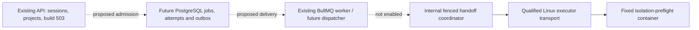

# Phase D4: isolated executor foundation and D3 handoff qualification

Date: 2026-10-30 (Asia/Tashkent). Baseline: `287d645d3c2443ea0f65a212d71a2d90ebc9db38`. Branch/worktree: `ai/codex-backend` / `NEXOS-codex`.

**Android compilation remains unavailable. Public build requests retain the authenticated 503. No Android source, SDK, container image, ROM ZIP or artifact was downloaded/generated.**

## Audit and scope

D2 contains seven reviewed source observations and the generic AOSP 16 r4 Cuttlefish x86_64 userdebug candidate. Source declarations do not establish complete source closure, an eligible compiler target, validated output or physical-device flashability. Build/flash eligibility remains false.

D3 already has strict connectivity probes in BullMQ/Redis: sixteen retained slots, deduplication, ownership comparisons, cancellation, concurrency two, bounded retries, poison-job rejection and killed-worker recovery tests. Later supervision bounds startup/shutdown and exits on consumption-loop termination. None of that supplies durable Android jobs, transactional authenticated admission, an outbox, production executor or artifact publication.

The smallest additional D3 milestone delivered here is **fenced internal handoff qualification**. It establishes and tests the authority/lifecycle/recovery protocol required before a queue worker allocates external resources. D4 then adds a fixed-command Linux preflight transport and isolation policy. Neither is wired into `main.ts`, public submissions or production queues. A Redis record or preflight exit zero never becomes a successful Android build.

No database migration or shared API/Zod/OpenAPI contract changes were needed. Production D3 and Linux host qualification remain incomplete; this is the verified internal foundation milestone, not completion of either entire production phase.

## Responsibility boundaries

The API owns sessions, CSRF and project/revision authorization; it never accepts a command/image/host path for execution. A future durable admission service must resolve an owned immutable revision and approve a target before publishing a queue message. Queue delivery is a scheduling hint, not execution authority. The coordinator owns grants/leases/progress/cancellation. The Linux transport owns fixed native operations and cleanup; it does not import API authentication/configuration or publish artifacts. These are code/authority boundaries, not a newly deployed RPC service. A remote service will additionally need authenticated transport and separate host configuration.

The qualification ledger uses an existing BullMQ Queue's Redis client/key namespace. It is not a second framework, public queue producer or new production consumer. The existing connectivity worker/contracts are unchanged. `createTestAttemptStore` requires NODE_ENV=test and an exact random `nexos-test-d4-<16 hex>` prefix, preventing accidental execution from production probe traffic.

## D3 milestone: handoff authority and lifecycle

- Admission accepts exactly requestId/revisionId. Actor identity is separate trusted context. An authorization callback must resolve matching owner/revision and immutable snapshot digest. Commands, environment, owner IDs, evidence and artifact paths are rejected as request fields. Tests use controlled callbacks; a real API/PostgreSQL resolver is not implemented or claimed.
- Target identity is exactly the D2 Cuttlefish candidate. This identity allowlist is not a source-evidence refresh or build eligibility decision. Revision/snapshot/target digests bind owner-scoped idempotency; changed content under the same request conflicts.
- One Lua script uses Redis TIME and atomic hash updates. Sixteen retained records bound admission; terminal identities are never silently evicted/reused. This is an internal test capacity, not production quota/retention design.
- At most one PREPARING/RUNNING/RECOVERY_REQUIRED reservation exists. Each attempt has a server UUID and increasing fence, with two attempts maximum. Expired/stale grants cannot renew, progress or publish.
- Progress is ordered: ALLOCATED (reservation), ISOLATED (container created), PREFLIGHT_RUNNING (start acknowledged). Reports contain discriminator, compiled:false, stage and fence; no percentage, raw logs, credentials or user command output.
- Queued cancellation is terminal immediately. Active cancellation remains a request until cleanup confirmation. Cancellation accepted before finalization wins over CHECKED. Terminal state cannot reopen.
- Crashed/expired work enters RECOVERY_REQUIRED and holds capacity until exact old-attempt cleanup is confirmed. Replacement attempts get new UUIDs/higher fences; stale publication fails. Cleanup failure/timeout quarantines the reservation instead of pretending resources stopped.
- Redis/authority errors and malformed stored state fail with controlled codes; raw exceptions are not persisted. A corrupted compiled:true record is rejected. These internal codes are not HTTP contracts.

| State              | Meaning and exits                                                                                                           |
| ------------------ | --------------------------------------------------------------------------------------------------------------------------- |
| QUEUED             | Internal preflight intent; claim to PREPARING or cancel to CANCELLED.                                                       |
| PREPARING          | Fenced reservation and ordered allocation/isolation; then RUNNING, confirmed terminal failure/cancel, or RECOVERY_REQUIRED. |
| RUNNING            | Fixed preflight start acknowledged; terminal writes require current authority and cleanup.                                  |
| CHECKED            | Isolation preflight only, always compiled:false. Never Android success.                                                     |
| FAILED / CANCELLED | Terminal internal check, not an artifact outcome.                                                                           |
| RECOVERY_REQUIRED  | Holds capacity. Confirm cleanup, then QUEUED if retries remain, CANCELLED if requested, otherwise FAILED.                   |

Defaults are a three-second lease, thirty-second execution deadline and five-second cleanup grace. Heartbeats are serialized. Cancellation/lease loss abort the transport. Cleanup cannot extend a successful preflight past its original deadline. Promise.race never releases resources alone: termination must confirm cleanup and the final write must still pass fencing. Errors/timeouts are terminal; crash recovery alone may retry within the two-attempt budget.

Redis state survives a restarted coordinator while Redis retains it, as tested. **This is not PostgreSQL-backed durable history, an outbox, a backup/restore guarantee or protection against Redis data loss.** No compiler may use this test ledger. Production admission, durable fences, transactional revision ownership, queue reconciliation, quotas and audit history must first use the coordinated durable design proposed in D3.

## D4 Linux transport

There is no default usable qualification or image. Native activation requires Linux, service UID 10001, a canonical private `/var/lib/nexos/executor` directory owned by that UID and fresh operator qualification (maximum age 24 hours). Qualification asserts rootless Docker, cgroup v2, independently verified enforcement and an external deadline/orphan reaper. These assertions are trusted operator input, not an implemented host verifier or evidence of successful testing. Job/API input cannot supply them. Windows rejects activation before filesystem/process execution.

The transport invokes only `/usr/bin/docker` with argument arrays and shell:false against a fixed rootless Unix socket. It creates the pinned `nexos/isolation-preflight@sha256:<digest>` image with pull=never and the fixed `/usr/local/bin/nexos-preflight` entrypoint, then starts the named container and waits for its exit status. No real image/digest has been selected/downloaded; a real program/image must be built and reviewed separately.

The plan specifies CPU 1, RAM/swap ceiling 512 MiB, pids 64, file descriptors 256, network none, read-only root, all capabilities dropped, no-new-privileges, UID/GID 10001, init/reaping, private IPC, 16 MiB shared memory and no daemon log retention. Separate noexec/nosuid/nodev tmpfs mounts bound work to 64 MiB and artifact scratch to 16 MiB. These small budgets are **preflight limits, not AOSP capacity**. No host binds, guest daemon sockets, devices, privileged flags, user environment or source/toolchain commands are accepted. See [Docker resource controls](https://docs.docker.com/engine/containers/resource_constraints) and [container CLI controls](https://docs.docker.com/reference/cli/docker/container/run); flags do not certify deployed enforcement.

CLI children receive a minimal fixed environment and empty private Docker configuration instead of inherited API/DB/HMAC/Redis secrets. CLI output is capped at 64 KiB and never logged; container identity, start acknowledgement and wait status are the protocol outputs. CLI process groups receive TERM then KILL on abort/deadline. That alone is not container termination: cleanup checks exact attempt/fence labels, removes the matching container and confirms absence through a successful daemon query. A daemon failure is not absence. Cleanup remains possible after qualification expires.

Each attempt receives a fresh private UUID directory and exclusive identity marker; an existing directory requires recovery. The empty artifacts-quarantine directory is separate from control metadata, never served and never mounted into this preflight. Cleanup checks canonical paths, owner/mode, symlink status and the exact attempt/fence marker before removing only that directory. No user path enters recursive cleanup. The Linux host/service user and daemon remain trusted; this does not sandbox a compromised host/daemon administrator.

Worker death during a daemon operation cannot prove resource death by losing a lease. A private control-pending marker is written before create/start and removed only after acknowledgement. An unconfirmed CLI exit also leaves a control-uncertain marker. Cleanup may stop the matching container, but these markers prevent automatic reservation release/retry even if an inventory query momentarily shows no container. Only an independently verified host reconciler may clear them after proving old control work is finished. That external reaper/durable protocol must reconcile labelled deadlines, pending daemon operations and orphan workspaces. No reaper is deployed here. Native process-group handling, actual cgroups, OOM/pid/disk exhaustion, network isolation and daemon crash races **have not run on this Windows host**. Plan/implementation coverage is not a successful Linux isolation test.

## Artifacts

No extraction, download or publisher exists. Results cannot represent compiled:true. Future genuine output must enter private quarantine under generated job/attempt/fence identity, with source/configuration/executor provenance, size/count bounds, SHA-256 and independent format/boot validation. Reject symlinks, traversal, unexpected files and stale attempts before promotion. Publish atomically only for the durable current attempt, then enforce owner access, expiry, retention and reconciled failure cleanup. A tmpfs path, source declaration or queue acknowledgement is never a downloadable ROM.

## Coverage matrix

| Area        | Verified here                                                                                                                                                                | Still missing                                                                                                                                |
| ----------- | ---------------------------------------------------------------------------------------------------------------------------------------------------------------------------- | -------------------------------------------------------------------------------------------------------------------------------------------- |
| D2          | Identity matches registry; unsupported refs/products/architecture rejected; build eligibility false.                                                                         | Complete source/prebuilt/toolchain closure, licensing/signatures, actual build.                                                              |
| Existing D3 | Real queue/retry/cancel, killed-child recovery and supervision regressions remain active.                                                                                    | Durable Android jobs/outbox/admission and production job/status/cancel APIs.                                                                 |
| New D3      | Real Redis atomic admission, ownership/digests/capacity, leases/fences, cancel/timeout, authority loss, stale-result rejection, cleanup gating and bounded restart attempts. | Production queue binding/PostgreSQL authority. New restart tests use expired grants/new coordinator instances, not a native container crash. |
| D4          | Pure resource/command policy validation, Windows refusal, Linux transport code and controlled transport protocol tests.                                                      | Qualified Linux host, real image/program, external reaper, actual native security/fault-injection verification.                              |
| Artifacts   | Private-directory policy and compiled:false invariant.                                                                                                                       | Real outputs, validation, storage/publication/downloads.                                                                                     |

Transport doubles model successful/failing/hung/terminated **preflight protocol operations only**. Redis state/fencing are real. They prove neither Linux container execution nor Android compilation.

## Files and integration impact

- `apps/worker/src/executor/policy.ts`: target, limits and progress.
- `apps/worker/src/executor/attempt-store.ts`: isolated admission/lease/fence/state authority.
- `apps/worker/src/executor/coordinator.ts`: heartbeat/deadline/cancel/cleanup/recovery protocol.
- `apps/worker/src/executor/linux-plan.ts`: immutable container plan and qualification gates.
- `apps/worker/src/executor/linux-transport.ts`: Linux-only fixed operations and private workspaces.
- `tests/executor-policy.test.ts`, `tests/executor-handoff.integration.ts`: policy/real-Redis qualification.
- This report, backend implementation handoff and frontend coordination note.

No apps/web implementation, existing worker entrypoint, dependencies/lockfile, shared schemas/OpenAPI, environment, Prisma schema or migration changed. No public operation or required environment variable was added. Gemini uses unchanged account/project APIs; build POST remains 503. Redis fixtures use enforced random prefixes and exact cleanup, never FLUSHDB. API/E2E tests use nexos_test. All 28 development-model count/digests and the .env digest are compared read only before/after testing.

## Verification ledger

Logs remain ignored `.local/d4-*` files. Full production workspace build used command-local NODE_ENV=production, API_ORIGIN=http://localhost:4200, installed Prisma engine paths and `pnpm exec turbo build --env-mode=loose`.

| Executed check                                                                                   | Final result                                                                                                                                                       |
| ------------------------------------------------------------------------------------------------ | ------------------------------------------------------------------------------------------------------------------------------------------------------------------ |
| `pnpm.cmd test`                                                                                  | 83 passed, zero failures/skips: 78 prior cases plus five executor policy cases.                                                                                    |
| `pnpm.cmd typecheck`, `pnpm.cmd lint`                                                            | Passed root/test checks and seven workspace tasks; final runs had six cached tasks.                                                                                |
| `pnpm.cmd --filter @rom-hub/worker build`, API build                                             | Passed; worker rebuilt again after uncertainty-marker and late-cleanup classification corrections.                                                                 |
| Production `pnpm.cmd exec turbo build --env-mode=loose` with settings above                      | Seven successful tasks, four cached. No fresh web rebuild claim; frontend source is unchanged.                                                                     |
| `node --env-file=.local/windows-runtime/test.env scripts/with-env.mjs pnpm test:integration`     | Final full supported run: 29 passed, zero failed/skipped, approximately 75 seconds. Includes all prior 24 cases and five new real-Redis cases.                     |
| Focused handoff integration through `pnpm exec tsx --test tests/executor-handoff.integration.ts` | Five passed again after adding a timeout-during-cleanup regression and correcting its stored failure classification.                                               |
| Focused `tsx --test tests/executor-policy.test.ts`                                               | Five passed again against the final Linux adapter on Windows; native activation was refused.                                                                       |
| Existing Windows Playwright wrapper, foundation and protected-routes specs                       | Eight passed in installed Edge, approximately 49 seconds, on isolated API/web ports 4200/3100 with nexos_test.                                                     |
| `pnpm.cmd audit --json`, `pnpm.cmd audit --prod --json`                                          | Both exit zero, zero advisories at every severity; audit metadata totals 644 / 268 dependencies. No dependency changed.                                            |
| Data/environment preservation                                                                    | All 28 model digests plus .env matched after service recovery. Later live auth activity is accounted for below. No database reset, migration or seed was executed. |
| Formatting / `git diff --check`                                                                  | Changed TypeScript/docs and whitespace checks passed.                                                                                                              |

The E2E command was `node --env-file=.local/windows-runtime/test.env scripts/with-env.mjs pnpm exec playwright test --config=apps/api/scripts/playwright-windows.config.ts tests/e2e/foundation.spec.ts tests/e2e/protected-routes.spec.ts`, with PLAYWRIGHT_API_PORT=4200 and the installed Edge executable override. No Gemini files/process were modified by these tests.

During the final preservation check, the active development frontend returned on port 3000 and real auth requests were visible in the API's redacted route log. Users increased from two to three, AuditLog from two to three, and Session rows changed. A follow-up read-only digest check verified both original users and both original audit rows intact; the remaining 25 model digests and .env were unchanged. These live changes were not rolled back or cleaned. The test URL was rechecked as nexos_test, while development checks used nexos_development. The executor foundation never writes PostgreSQL.

Preliminary failures are disclosed: TypeScript caught callback narrowing, literal timeout inference and BullMQ client signatures; corrected. One regression attempt encountered stopped services; PostgreSQL logged a terminated backend/failed restart. The helper restarted saved data/Redis, PostgreSQL performed normal WAL recovery, and all development/environment digests matched. No reset, migration or seed occurred. Direct tsx integration then passed 28/29 but bypassed pnpm dependency resolution for the existing C5 compiler helper. Other attempts hit the existing five-second failed-start deadline or first-API readiness bound. Final supported project verification passed all 29 without weakening/changing those assertions. Automatic approval review rejected a shell-based report write before execution (blocked by policy); this file was written as a non-executable patch instead.

## Git delivery

The D3 handoff prerequisite is commit `3b8f373bc7aeade8f843fcb0381e945baf1bd33b`. The Linux foundation is `7db9cb75cf63272c7b876fbb20110b37c323c23f`, with conservative uncertainty markers in `14e13570cee0483552073891101b926f5f1bb82e` and timeout classification in `60eeffbcbc1a00f08d332b8b3253747412baad5f`. This documentation is delivered afterward. All changes remain on ai/codex-backend for the existing [Draft PR #1](https://github.com/Abubakr-63/NEXOS/pull/1); no merge, force push or shared history rewrite is authorized or performed.

## Next milestone and stop

Stop after this verified foundation is pushed. First coordinate durable PostgreSQL job/attempt/outbox and API-to-queue admission with execution disabled. Separately qualify a Linux identity/rootless daemon/cgroup host and build/review a small real isolation-preflight image. Verify cancellation/process death, OOM/pid/tmpfs limits, secret/network isolation, host/daemon failure recovery and a reaper. Then review immutable Cuttlefish source/toolchain closure and resource-qualified isolated preparation/lunch. The first compilation needs a separately bounded scope, provenance and virtual boot validation. No massive source/toolchain download or AOSP build begins here.
